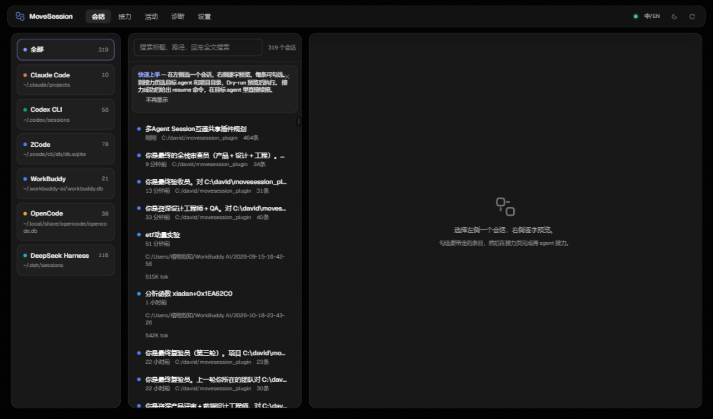
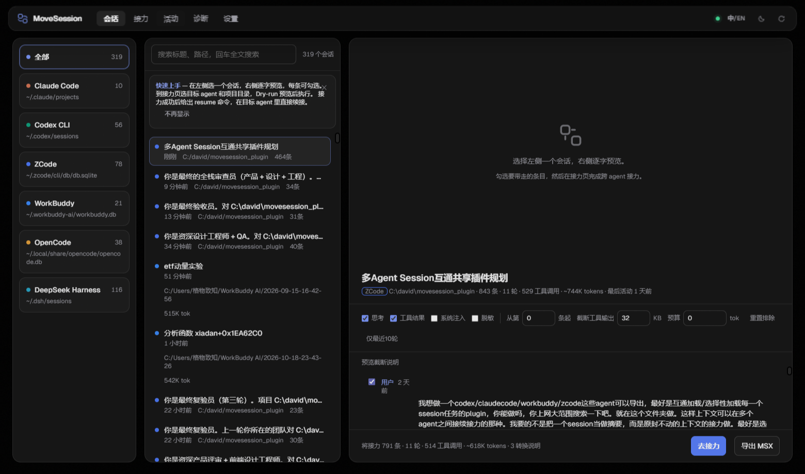
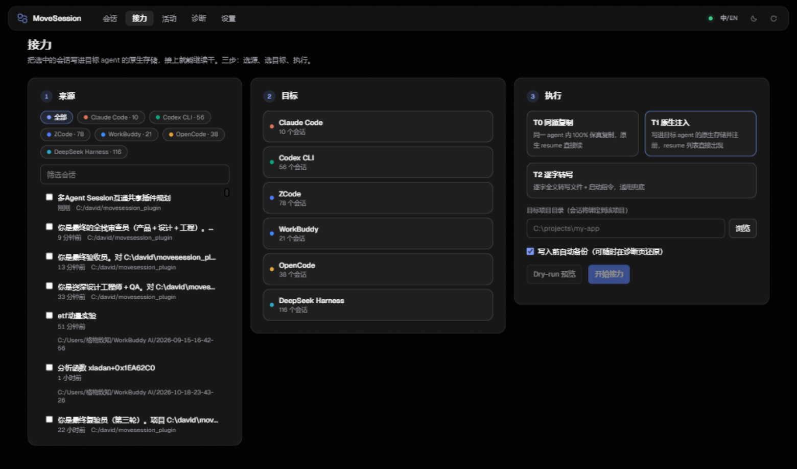

<div align="center">


# AgentRelay

**Move a half-finished coding session from one AI agent to another — the whole session, not a summary of it.**

[](LICENSE) [](https://github.com/DavidLi-TJ/AgentRelay/actions/workflows/ci.yml) [](https://m8ven.com/mcp/davidli-tj/agentrelay?s=readme) [](https://nodejs.org) [](#quick-start) [](#quick-start)

English ｜ [简体中文](README.zh-CN.md) · [User guide](docs/USER-GUIDE.md) · [Quick start](#quick-start) · [Support matrix](#support-matrix) · [Relay tiers](#three-ways-to-relay) · [FAQ](#faq)



</div>

```bash
npx @ldavidl/agentrelay serve   # zero install, zero dependencies
```

## The problem

You spend three hours in Claude Code. The task is half done and the agent finally knows every quirk of the codebase. Then you hit a usage cap, or you just want Codex to take over. What happens to the session? A copy-pasted summary loses the tool calls, the error output, and the exact state of the work. Starting over throws away the whole afternoon.

AgentRelay moves the session itself. Every message, tool call, tool result, and thinking block is read from the source agent's local storage and written into the target agent's native store, so its own resume command picks the session up as if it had always been there.

Nothing is summarized, nothing is uploaded, and there is nothing to install — the app is a handful of JavaScript files run by the Node.js you already have.

One more thing worth saying plainly: everything above happens in a browser page. The other tools in this space — ccusage, claude-code-history-viewer, the various handoff scripts — are terminal commands you run, with flags to memorize and JSON to squint at. AgentRelay gives the same job a real interface: agents as cards, sessions as a list you can search, the conversation laid out with checkboxes. If you can use a web app, you can relay a session. The CLI and MCP interfaces exist, but they are optional doors, not the front door.

## What it does

- **One page for every session.** Eleven agents (Claude Code, Codex CLI, ZCode, WorkBuddy, OpenCode, DeepSeek Harness, Gemini CLI, Pi, OpenClaw, VS Code Copilot, Cursor), browsable, filterable, and full-text searchable, with verbatim preview on the right.
- **Carry only what you want.** Check entries one by one, or set the stage with toggles for thinking blocks, tool results, and system injections, a from-entry offset, a token cap, and regex-based secret redaction.
- **Write into the target, not at it.** Relay synthesizes the target agent's own session format and registers it, so `claude --resume` / `codex resume` / the desktop session list just works.
- **Back up first, always.** Any write that touches an existing database takes a consistent SQLite snapshot (`VACUUM INTO`) first; relays that only create brand-new files don't need one. Twenty are kept, and the Diagnostics page restores any of them.
- **Relay from inside an agent.** A stdio MCP server exposes six tools, so Claude or Codex can hand a session to another agent while you talk to it.

<div align="center">

</div>

## Quick start

Windows 10/11 (fully verified), Node.js 22.5 or newer (for the built-in `node:sqlite` module). No `npm install` — there are no dependencies to install. Linux/macOS: adapters read the same `~/.` paths and the storage paths are in place, but not yet broadly field-tested — real-world feedback is welcome (open an issue if something misbehaves).

```bash
npx @ldavidl/agentrelay serve  # one command, then open http://127.0.0.1:17777
# or: npx github:DavidLi-TJ/AgentRelay serve · double-click StartAgentRelay.bat after cloning (Windows)
# or: ./start.sh after cloning (Linux/macOS)
```

That is the whole setup. A browser window opens at `http://127.0.0.1:17777`. New here? The [user guide](docs/USER-GUIDE.md) walks through every screen in the order you'll use them.

The first-run wizard detects which agents you have and shows a live session count for each. From here everything is point-and-click:

1. **Sessions page** — pick an agent on the left rail, type in the search box, click a session. The right pane shows the full conversation verbatim: text, tool calls with their inputs and outputs, thinking blocks.
2. **Choose what to carry** — the bar above the preview holds the switches: thinking, tool results, system injections, redaction, a start offset, tool-output truncation, and a token cap. The cap takes presets: **1M / 512K / 200K**, or any number. If the session has been compacted, **From last compact** starts the relay at the newest compaction boundary — what you get on the other side matches what the source agent still has in its head.
3. **Relay page** — pick the source sessions, click a target agent card, pick the relay tier (a badge marks the recommended one and explains why), set the target project folder with the folder browser, then click **Dry-run**.
4. **Dry-run** walks the entire pipeline without writing anything and reports the path it would write, the entry count, the token estimate, and every conversion note. Read it, then click **Start relay**. A confirmation appears, the backup runs, and the result panel hands you the resume command.

That is the whole workflow. The CLI (`node cli.js ...`) and the MCP server exist for scripting and for agents, but nothing in the daily loop requires a terminal.

<div align="center">

</div>

## Three ways to relay

| Tier | What it does | Fidelity |
|---|---|---|
| **T0 · same-agent copy** | Native copy inside one agent with a new session id, rebuilt message chain, rewritten cwd. For Claude→Claude, Codex→Codex, ZCode→ZCode, and the file-based agents (Gemini, Pi, OpenClaw, VS Code Copilot, DeepSeek Harness). | 100%, `resume` continues directly |
| **T1 · native injection** | Synthesizes the target agent's own session format, writes it into the target's storage, and registers it. Every supported target has a native writer. | Structurally equivalent, verbatim |
| **T2 · verbatim transcript** | Writes the full session as a structured transcript into the target project plus a kickoff prompt for a new session. Universal fallback. | Content 100% verbatim |

Which tier for which target? The app marks it on the relay page, and the short version is:

- Same agent → **T0**. There is no reason to use anything else.
- Any other supported target → **T1**, the default. Native injection; resume or the session list picks it up. Experimental writers are flagged in the UI.
- **T2** stays as the universal fallback for anything without a native writer.

Cross-agent relays cannot replay thinking-block signatures (that requires the vendor's private key), so signatures are kept as plain text and noted in the `loss[]` manifest. T0 has no loss. Every relay result carries a fidelity manifest: tier, kept entries/tools/thinking counts, and the list of omissions.

## Cross-device relay

Sessions live on one machine, but work moves. Export selected sessions (or a whole agent) into a single `.arxbundle` file — a plain local JSON container, no cloud involved — carry it over any drive or sync folder, and import it on the other side. Because the target agent binds sessions to project paths, the import wizard rewrites source-machine paths to the local machine (path remapping) before injecting, which is what makes a T1 session resumable on the new machine. The CLI does the same: `node cli.js bundle out.arxbundle --from claude:<id>` then `node cli.js import-bundle out.arxbundle --to codex --remap "D:/work=/Users/x/work"`.

## Support matrix

| Agent | Local storage | As source | As target | Resume |
|---|---|---|---|---|
| Claude Code | `~/.claude/projects/` | ✓ | T0 / T1 / T2 | `claude --resume` |
| Codex CLI | `~/.codex/sessions/` + `state_5.sqlite` | ✓ | T0 / T1 / T2 | `codex resume` |
| ZCode | `~/.zcode/cli/db/db.sqlite` | ✓ | T0 / T1 / T2 | Desktop session list |
| WorkBuddy（国内版）| `~/.workbuddy/workbuddy.db` | ✓ | T1 / T2 | Desktop session list |
| WorkBuddy AI（国际版）| `~/.workbuddy-ai/workbuddy.db` | ✓ | T1 / T2 | Desktop session list |
| OpenCode | `~/.local/share/opencode/opencode.db` | ✓ | T1 / T2 | Session list |
| DeepSeek Harness | `~/.dsh/sessions/` (multi-frame zstd) | ✓ | T0 / T1 / T2 | Session list |
| Gemini CLI (experimental) | `~/.gemini/tmp/*/chats/` | ✓ | T0 / T1 / T2 | `gemini` `/resume` |
| Pi / OpenClaw (experimental) | JSONL | ✓ | T0 / T1 / T2 | Session list |
| VS Code Copilot (experimental) | `workspaceStorage/<hash>/GitHub.copilot-chat/transcripts/` | ✓ | T0 / T1 / T2 | Chat History |
| Cursor (experimental) | `globalStorage/state.vscdb` (`composerData`/`bubbleId` + `composerHeaders`) | ✓ | T1 / T2 | Chat History |
| Doubao Work (experimental) | in-app IndexedDB + cloud (no local session store) | ✓ | T2 | task reads the transcript file |

Experimental adapters are implemented from official source schemas (Cursor's from community reverse-engineering, since no import API exists) and pass synthetic-sample tests. Notes: the two WorkBuddy editions are separate installs and appear as separate cards — domestic reads/writes only `~/.workbuddy`, international only `~/.workbuddy-ai`, never mixed; VS Code does not persist tool outputs — relayed sessions carry a placeholder there; Cursor T1 requires Cursor to be fully closed while writing (its in-memory state can overwrite external edits on exit) and takes a workspace-database snapshot first; DeepSeek Harness as a native target needs the zstd built into Node ≥ 23.8 (older Nodes are auto-downgraded to T2 in the UI). Trae stays on hold: its agent database is SQLCipher-encrypted with the key generated inside Trae's own backend (a T2 relay into a Trae project still works). Doubao Work keeps its session transcripts inside the app's own IndexedDB/cloud with no local native store, so it is T2-only: the verbatim transcript lands in the local folder your Doubao project has bound, and the result panel gives you a kickoff prompt to paste into a new work task. Several instances of the same agent (say, two Claude config directories) can be added in Settings.

## How it compares

| | AgentRelay | session-migrate | MoveZ | baton / handoff-style |
|---|---|---|---|---|
| Interface | Web GUI | CLI | Desktop app + CLI | CLI |
| Transfer fidelity | Verbatim (T0 byte-identical, T1 native synthesis) | Native, per-route tables | Native | Summary handoff |
| Selective loading | Per-entry checkboxes, token budget, compaction boundary | — | — | — |
| Cross-device | `.arxbundle` + path remapping | — | Encrypted bundles | Encrypted paste push |
| Safety | Auto-backup + dry-run + fidelity manifest | Manifest | Backup | — |
| Dependencies | 0 (Node built-ins only) | Python | PHP/Vue/Electron | Go |
| Platform | Windows first | Linux first | macOS first | Linux/macOS |

## Edit context, find duplicates, browse sub-sessions

Agent sessions drift. An agent loops on "let me do it", a tool result pollutes the context, a wrong turn poisons everything after it. The detail page has an **Edit** mode for that: filter entries by keyword, rewrite or remove entries, insert new ones (user / assistant / a tool-call pair, or paste an exported ARX fragment from another agent to batch-merge), and copy any entry verbatim. Saving offers two modes: **save in place** (claude and zcode — writes the session's own storage, auto-backup first, takes effect the next time that agent opens the session) or **save as a new session** (every agent, original untouched). Editing is your explicit action — relays still never modify a source session. Any session can also be exported as a **verbatim Markdown transcript** (your selection and redaction apply, tool calls and thinking render as collapsible blocks) or as an ARX JSON file — the two buttons sit side by side under the preview.

Three honest caveats: an in-place claude save re-synthesizes the transcript, so sidechain/system-injection lines that the format cannot round-trip are dropped (the backup is the recovery); the editor reaches the first 400 loaded entries (click **Load more** to bring further ones in); and a pasted tool pair is kept adjacent for exactly this reason — a `tool_result` far from its `tool_use` makes `claude --resume` fail.

The sessions toolbar has a **duplicate finder**: sessions with the same title, size and project across all agents are grouped (migration testing leaves copies behind), one click jumps to each. Sub-agent sessions (zcode) show up under their parent in the detail view. And a settings switch turns auto-loading of session lists off entirely — click an agent to scan it on demand, disabled agents are never touched.

## Selective loading, compaction, and big sessions

Selection runs on a unified intermediate format (ARX) that keeps every entry verbatim, so filtering never rewrites content. Tool calls stay paired with their results even after aggressive filtering, which is what keeps the target agent's resume from choking.

Large sessions open instantly because the preview pages through (200 entries first, more on demand) while stats are computed server-side. A token cap degrades oldest-first until the payload fits, so a 2M-token monster becomes a 1M-token payload with one click.

## MCP

Register once, then relay conversationally:

```bash
claude mcp add agentrelay -- node C:\path\to\agentrelay\cli.js mcp
```

Six tools: `list_agents`, `list_sessions`, `get_session`, `preview_transfer`, `transfer`, `doctor`. `transfer` is dry-run unless you pass `confirm: true`. Details in [docs/MCP.md](docs/MCP.md).

## Safety

Any write that could overwrite existing data is preceded by a backup: a consistent SQLite snapshot via `VACUUM INTO` (file stores are copied as-is), the last 20 kept under the backup root shown on the Diagnostics page, one click to restore. T0 and T1 into a database target and every OpenCode/WorkBuddy/Codex/ZCode write get this snapshot; relays that only create brand-new files (T2 transcripts, first-time writes into an empty Claude project folder) don't need one. Database writes run in transactions and roll back on failure; file writes land through temp-file-plus-rename and never touch the source session. The MCP channel stays dry-run without an explicit `confirm: true`. The local server checks the Host header, accepts only JSON POSTs, and caps request bodies at 64 MB. There is no telemetry and no network call of any kind unless you turn on the update check.

## Where your data lives

The app keeps its own files in `~/.agentrelay` — config, backups, exports, cache, logs. Change the folder in Settings if you prefer somewhere else. The sessions themselves always stay in each agent's own storage; AgentRelay reads them and writes to them, but never moves or owns them.

## FAQ

<details>
<summary>Does my session data leave my machine?</summary>
No. Reads and writes stay on your disk. The only optional network request is the update check you enable in Settings.
</details>

<details>
<summary>Can a relay corrupt my existing sessions?</summary>
The backup runs first, writes are transactional or atomic, and the Diagnostics page restores any of the last 20 backups.
</details>

<details>
<summary>Will the target agent actually accept the session?</summary>
T0 is a native copy, so resume just works. T1 is written into the target's native store and registered. T2 hands the target a verbatim transcript plus a kickoff prompt. All three were verified against real agent storage on Windows (real sessions, real resume).
</details>

<details>
<summary>Original text or a summary?</summary>
Original text. ARX keeps every message, tool call, and result verbatim; your selections decide what to carry, never what to rewrite.
</details>

<details>
<summary>How is this different from ccusage or claude-code-history-viewer?</summary>
Those answer "what happened in my sessions". AgentRelay answers "continue this session somewhere else".
</details>

## Sponsor

If AgentRelay saved you some time, a coffee is always appreciated:

<p align="center">
  
  &nbsp;&nbsp;&nbsp;&nbsp;
  
</p>

## Star History

[](https://star-history.com/#DavidLi-TJ/AgentRelay&Date)

## Development

```text
server/core/    storage adapters, ARX format, selector, relay orchestration
server/public/  web GUI (vanilla JS, no build step)
scripts/        sandbox-test.js · e2e.js
docs/           format-notes.md · MCP.md · USER-GUIDE.md
```

```bash
node scripts/sandbox-test.js
```

## License

[MIT](LICENSE)

Issues and pull requests are welcome — bug reports with a diagnostic bundle (Diagnostics page → Export) are the fastest way to get something fixed.
