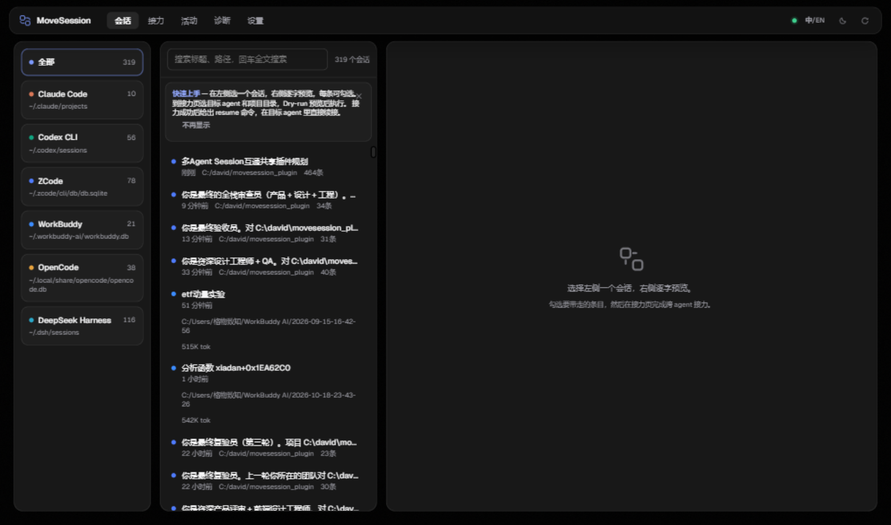
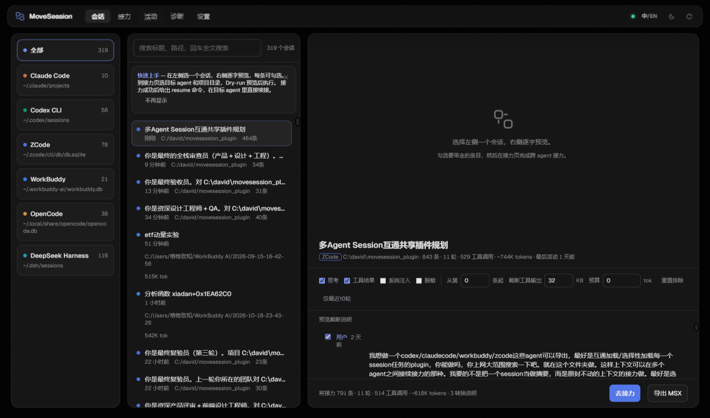
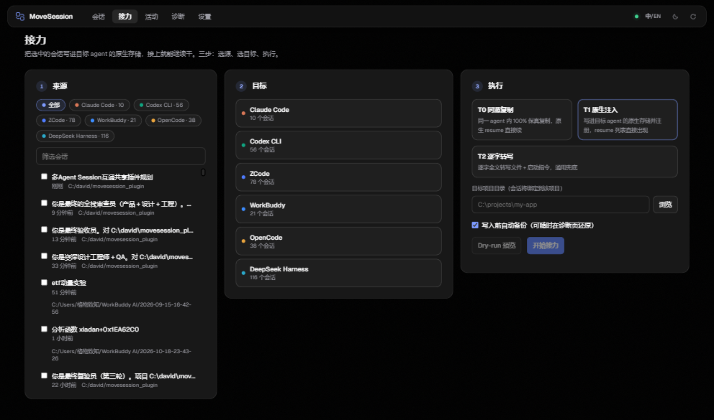

<div align="center">


# AgentRelay

**把一个 AI agent 做到一半的会话，整个搬给另一个 agent——搬的是会话本身，不是摘要。**

[](LICENSE) [](https://nodejs.org) [](#快速开始) [](#快速开始)

[English](README.md) ｜ 简体中文 · [快速开始](#快速开始) · [支持矩阵](#支持矩阵) · [接力级别](#三种接力方式) · [FAQ](#faq)



</div>

## 这解决什么问题

你在 Claude Code 里干了三个小时，任务做到一半，agent 终于摸清了代码库的每个坑。这时候用量到顶了，或者你就是想让 Codex 接手。会话怎么办？复制粘贴一份摘要，工具调用、报错输出、工作现场全丢了；从头再来，一下午白费。

AgentRelay 搬的是会话本身：每条消息、每次工具调用和结果、每个思考块，从源 agent 的本地存储里读出来，写进目标 agent 的原生存储，然后目标 agent 自己的 resume 命令就能接着跑，像这场会话本来就属于它。

不摘要、不上传、不安装——整个软件就是一堆 JS 文件，用你机器上已有的 Node.js 跑起来。

还有一件事值得直说：以上全部发生在一个网页里。同类工具——ccusage、claude-code-history-viewer、各种 handoff 脚本——都是命令行命令，要记参数、要盯 JSON 输出。AgentRelay 给同一件事做了真正的界面：agent 是卡片，会话是可搜索的列表，对话逐条铺开带勾选框。会用网页就会接力。CLI 和 MCP 接口都在，但它们是侧门，不是正门。

## 功能一览

- **一个页面看全所有会话**：十家 agent（Claude Code、Codex CLI、ZCode、WorkBuddy、OpenCode、DeepSeek Harness、Gemini CLI、Pi、OpenClaw、VS Code Copilot）的会话统一浏览、筛选、全文搜索，右侧逐字预览。
- **带走多少自己定**：逐条勾选；也可以用开关批量定——思考块、工具结果、系统注入、起始条数、token 上限、秘钥正则脱敏。
- **写进目标的原生存储**：合成为目标 agent 自己的会话格式并注册，`claude --resume`、`codex resume`、桌面端会话列表直接认。
- **先备份再写入**：每次写入前做 SQLite 一致性快照（`VACUUM INTO`），保留 20 份，诊断页一键还原。
- **在 agent 里对话式接力**：内置 stdio MCP server，六个工具，Claude 或 Codex 可以在你聊天时把会话递给另一个 agent。

<div align="center">

</div>

## 快速开始

Windows 10/11，Node.js 22.5 以上（为了内置的 `node:sqlite`）。零 npm 依赖，不需要 `npm install`。

**双击 `StartAgentRelay.bat`**，装完事。浏览器自动打开 `http://127.0.0.1:17777`。

首次运行向导会探测你装了哪些 agent，并实时显示各自的会话数。之后全程点鼠标：

1. **会话页**：左侧选 agent，搜索框过滤，点开一场会话。右侧逐字呈现全文——文本、带输入输出的工具调用、思考块。
2. **决定带走什么**：预览上方一排开关：思考、工具结果、系统注入、脱敏、起始条数、工具输出截断、token 上限。上限有快捷档 **1M / 512K / 200K**，也可以手输任意值。会话压缩过的话，点**「从最近 compact 起」**，从最后一次压缩边界开始接力——目标拿到的上下文，和源 agent 脑子里现在留着的一样。
3. **接力页**：勾选来源会话，点目标 agent 卡片，选接力级别（有徽章标出推荐级别并说明理由），用目录浏览器选目标项目目录，然后点 **Dry-run**。
4. **Dry-run** 把整条接力流程走一遍但不写盘，报告将写入的路径、条数、token 和每一条转换说明。看完没问题，点**开始接力**，确认、自动备份，结果面板给出 resume 命令。

这就是全部日常操作。CLI（`node cli.js ...`）和 MCP server 是给脚本和 agent 用的，日常用不到终端。

<div align="center">

</div>

## 三种接力方式

| 级别 | 做法 | 保真度 |
|---|---|---|
| **T0 · 同源复制** | 同一 agent 内原生复制：新会话 id、重建消息链、改写 cwd。用于 Claude→Claude、Codex→Codex、ZCode→ZCode。 | 100%，`resume` 直接续 |
| **T1 · 原生注入** | 合成为目标 agent 自己的会话格式，写入其存储并注册。 | 结构等价，内容逐字 |
| **T2 · 逐字转写** | 把整场会话转写成结构化 transcript 写进目标项目，附新会话的启动指令。 | 内容 100% 逐字 |

哪个目标用哪级？接力页会标出来，规律很短：

- 同一个 agent → **T0**，没有别的选择比它更好。
- 目标是 Claude Code、Codex CLI、ZCode、WorkBuddy、OpenCode → **T1**（默认推荐），原生注入，resume 或会话列表直接出现。
- 目标是 DeepSeek Harness、Gemini CLI、Pi、OpenClaw → **T2**，这几家还没有原生写入适配器，转写是唯一通道。

跨 agent 时思考块签名无法重放（需要厂商私钥），签名以原文保留并记入 `loss[]` 清单；T0 无损失。

## 支持矩阵

| Agent | 本地存储 | 作为源 | 作为目标 | 续接方式 |
|---|---|---|---|---|
| Claude Code | `~/.claude/projects/` | ✓ | T0 / T1 / T2 | `claude --resume` |
| Codex CLI | `~/.codex/sessions/` + `state_5.sqlite` | ✓ | T0 / T1 / T2 | `codex resume` |
| ZCode | `~/.zcode/cli/db/db.sqlite` | ✓ | T0 / T1 / T2 | 桌面端会话列表 |
| WorkBuddy | `~/.workbuddy-ai/workbuddy.db` | ✓ | T1 / T2 | 桌面端会话列表 |
| OpenCode | `~/.local/share/opencode/opencode.db` | ✓ | T1 / T2 | 会话列表 |
| DeepSeek Harness | `~/.dsh/sessions/`（zstd 多帧） | ✓ | T2 | 启动指令续接 |
| Gemini CLI（实验性） | `~/.gemini/tmp/*/chats/` | ✓ | T2 | 启动指令续接 |
| Pi / OpenClaw（实验性） | 各自 JSONL | ✓ | T2 | 启动指令续接 |
| VS Code Copilot（实验性） | `workspaceStorage/<hash>/GitHub.copilot-chat/transcripts/` | ✓ | T2 | 启动指令续接 |

实验性适配器基于官方源码 schema 实现并通过合成样本测试；Trae 因会话库 SQLCipher 加密暂缓。同一个 agent 可以在设置页添加多个实例（比如两个 Claude 配置目录）。

## 选择性加载、压缩与大会话

选择性加载跑在一个统一中间格式（ARX）上，所有条目逐字保存，筛选从不改写内容。即使过滤得很狠，工具调用和结果也保持配对完整——这是目标 agent resume 不报错的关键。

大会话秒开：预览分页加载（先 200 条，按需续），统计在后端算好。token 上限从最旧的条目开始降级，直到装得下为止——两百万 token 的怪物一点鼠标就变成一百万。

## MCP

注册一次，之后对话式接力：

```bash
claude mcp add agentrelay -- node C:\path\to\agentrelay\cli.js mcp
```

六个工具：`list_agents`、`list_sessions`、`get_session`、`preview_transfer`、`transfer`、`doctor`。`transfer` 不带 `confirm: true` 就只做 dry-run。详见 [docs/MCP.md](docs/MCP.md)。

## 安全

凡是可能覆盖既有数据的写入，之前都先备份：SQLite 一致性快照（`VACUUM INTO`，文件型存储直接复制），最近 20 份放在诊断页标出的备份根目录里，一键还原。T0/T1 写入数据库目标、以及 OpenCode/WorkBuddy/Codex/ZCode 的每次写入都享受这份快照；只新建文件、不覆盖任何东西的写入（T2 转写、往空项目目录首次写入 Claude）不需要备份。数据库写入包在事务里，失败回滚；文件写入走临时文件加 rename，绝不碰源会话。MCP 通道不显式给 `confirm: true` 就只做 dry-run。本地服务校验 Host 头、只收 JSON POST、请求体上限 64MB。没有遥测；除了你在设置里手动开启的版本检查，没有任何网络请求。

## 数据在哪

应用自己的文件在 `~/.agentrelay`——配置、备份、导出、缓存、日志，设置页可以换目录。会话本身永远待在各自 agent 的存储里；AgentRelay 读它们、写它们，但从不拥有它们。

## FAQ

<details>
<summary>会话数据会离开我的电脑吗？</summary>
不会。读和写都在本地磁盘。唯一的可选网络请求是你在设置里开启的版本检查。
</details>

<details>
<summary>接力会弄坏现有会话吗？</summary>
备份先行，写入要么事务要么原子落盘，诊断页能还原最近 20 份备份中的任何一份。
</details>

<details>
<summary>目标 agent 真的认这场会话吗？</summary>
T0 是原生复制，resume 直接续。T1 写入目标原生存储并注册。T2 给目标一份逐字 transcript 加启动指令。三种级别都用真实 agent 存储验证过（真实会话、真实 resume）。
</details>

<details>
<summary>接过去的是原文还是摘要？</summary>
原文。ARX 逐字保存每条消息、工具调用和结果；你的选择决定带走什么，从不决定改写什么。
</details>

<details>
<summary>和 ccusage、claude-code-history-viewer 有什么区别？</summary>
它们回答"我的会话里发生了什么"。AgentRelay 回答"这场会话换个地方继续"。
</details>

## 赞助

如果 AgentRelay 帮你省下了时间，欢迎请作者喝杯咖啡：

<p align="center">
  
  &nbsp;&nbsp;&nbsp;&nbsp;
  
</p>

## Star History

[](https://star-history.com/#DavidLi-TJ/AgentRelay&Date)

## 开发

```text
server/core/    存储适配器、ARX 格式、选择器、接力编排
server/public/  Web GUI（原生 JS，无构建步骤）
scripts/        sandbox-test.js · e2e.js
docs/           format-notes.md · MCP.md
```

```bash
node scripts/sandbox-test.js
```

## License

[MIT](LICENSE)

欢迎提交 Issue 和 PR——报 bug 时附上诊断包（诊断页 → 导出）修复最快。
