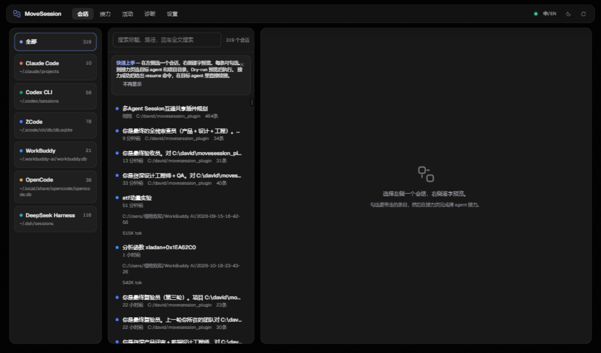
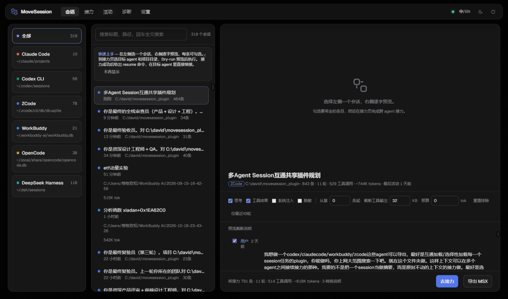
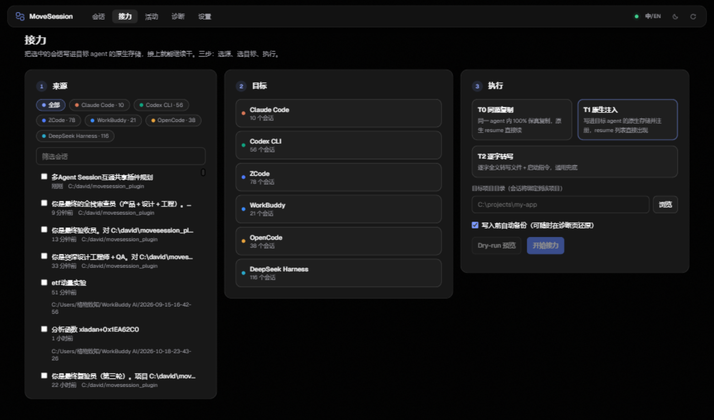

<div align="center">


# AgentRelay

**把一个 AI agent 做到一半的会话，整个搬给另一个 agent——搬的是会话本身，不是摘要。**

[](LICENSE) [](https://github.com/DavidLi-TJ/AgentRelay/actions/workflows/ci.yml) [](https://m8ven.com/mcp/davidli-tj/agentrelay?s=readme) [](https://nodejs.org) [](#快速开始) [](#快速开始)

[English](README.md) ｜ 简体中文 · [用户指南](docs/USER-GUIDE.zh-CN.md) · [快速开始](#快速开始) · [支持矩阵](#支持矩阵) · [接力级别](#三种接力方式) · [FAQ](#faq)



</div>

## 这解决什么问题

你在 Claude Code 里干了三个小时，任务做到一半，agent 终于摸清了代码库的每个坑。这时候用量到顶了，或者你就是想让 Codex 接手。会话怎么办？复制粘贴一份摘要，工具调用、报错输出、工作现场全丢了；从头再来，一下午白费。

AgentRelay 搬的是会话本身：每条消息、每次工具调用和结果、每个思考块，从源 agent 的本地存储里读出来，写进目标 agent 的原生存储，然后目标 agent 自己的 resume 命令就能接着跑，像这场会话本来就属于它。

不摘要、不上传、不安装——整个软件就是一堆 JS 文件，用你机器上已有的 Node.js 跑起来。

还有一件事值得直说：以上全部发生在一个网页里。同类工具——ccusage、claude-code-history-viewer、各种 handoff 脚本——都是命令行命令，要记参数、要盯 JSON 输出。AgentRelay 给同一件事做了真正的界面：agent 是卡片，会话是可搜索的列表，对话逐条铺开带勾选框。会用网页就会接力。CLI 和 MCP 接口都在，但它们是侧门，不是正门。

## 功能一览

- **一个页面看全所有会话**：十一家 agent（Claude Code、Codex CLI、ZCode、WorkBuddy、OpenCode、DeepSeek Harness、Gemini CLI、Pi、OpenClaw、VS Code Copilot、Cursor）的会话统一浏览、筛选、全文搜索，右侧逐字预览。
- **带走多少自己定**：逐条勾选；也可以用开关批量定——思考块、工具结果、系统注入、起始条数、token 上限、密钥正则脱敏。
- **写进目标的原生存储**：合成为目标 agent 自己的会话格式并注册，`claude --resume`、`codex resume`、桌面端会话列表直接认。
- **先备份再写入**：任何会触碰既有数据库的写入前都做一致性快照（SQLite `VACUUM INTO`），保留 20 份，诊断页一键还原；只新建文件的接力无需备份。
- **在 agent 里对话式接力**：内置 stdio MCP server，七个工具（含跨全部 agent 的会话正文全文搜索），Claude 或 Codex 可以在你聊天时把会话递给另一个 agent。

<div align="center">

</div>

## 快速开始

Windows 10/11（已完整验证），Node.js 22.5 以上（为了内置的 `node:sqlite`）。零 npm 依赖，不需要 `npm install`。Linux/macOS：适配器读取同样的 `~/.` 路径，存储路径已就绪，但尚未广泛实测——欢迎实际使用并反馈问题（异常请开 issue）。

```bash
npx @ldavidl/agentrelay serve  # 一条命令，然后打开 http://127.0.0.1:17777
# 或者：npx github:DavidLi-TJ/AgentRelay serve · 克隆后双击 StartAgentRelay.bat（Windows）
# 或者：克隆后运行 ./start.sh（Linux/macOS）
```

装完事。浏览器自动打开 `http://127.0.0.1:17777`。

首次运行向导会探测你装了哪些 agent，并实时显示各自的会话数。之后全程点鼠标。每个界面怎么用，[用户指南](docs/USER-GUIDE.zh-CN.md)按实际使用顺序逐一讲了一遍：

1. **会话页**：左侧选 agent，搜索框过滤，点开一场会话。右侧逐字呈现全文——文本、带输入输出的工具调用、思考块。
2. **决定带走什么**：预览上方一排开关：思考、工具结果、系统注入、脱敏、起始条数、工具输出截断、token 上限。上限有快捷档 **1M / 512K / 200K**，也可以手输任意值。会话压缩过的话，点**「从最近 compact 起」**，从最后一次压缩边界开始接力——目标拿到的上下文，和源 agent 脑子里现在留着的一样。
3. **接力页**：勾选来源会话，点目标 agent 卡片，选接力级别（有徽章标出推荐级别并说明理由），用目录浏览器选目标项目目录，然后点 **Dry-run**。
4. **Dry-run** 把整条接力流程走一遍但不写盘，报告将写入的路径、条数、token 和每一条转换说明。看完没问题，点**开始接力**，确认、自动备份，结果面板给出 resume 命令。

这就是全部日常操作。CLI（`node cli.js ...`）和 MCP server 是给脚本和 agent 用的，日常用不到终端。

<div align="center">

</div>

## 三种接力方式

| 级别 | 做法 | 保真度 |
|---|---|---|
| **T0 · 同源复制** | 同一 agent 内原生复制：新会话 id、重建消息链、改写 cwd。用于 Claude→Claude、Codex→Codex、ZCode→ZCode，以及文件型 agent（Gemini、Pi、OpenClaw、VS Code Copilot、DeepSeek Harness）。 | 100%，`resume` 直接续 |
| **T1 · 原生注入** | 合成为目标 agent 自己的会话格式，写入其存储并注册。所有支持的目标都有原生写入器。 | 结构等价，内容逐字 |
| **T2 · 逐字转写** | 把整场会话转写成结构化 transcript 写进目标项目，附新会话的启动指令。通用兜底。 | 内容 100% 逐字 |

哪个目标用哪级？接力页会标出来，规律很短：

- 同一个 agent → **T0**，没有别的选择比它更好。
- 其他任何支持的目标 → **T1**（默认推荐），原生注入，resume 或会话列表直接出现；实验性写入器会在界面标注。
- **T2** 是所有 agent 的通用兜底。

跨 agent 时思考块签名无法重放（需要厂商私钥），思考内容会转为带【思考】前缀的普通文本块保留——内容不丢，只是不可验证的签名消失；T0 无损失。每次接力结果都带保真度清单：级别、保留的条目/工具/思考计数、转换说明条数。

## 跨设备接力

会话存在一台机器上，但工作会移动。把选中的会话（或整个 agent）打包成单个 `.arxbundle` 文件——纯本地 JSON 容器，不经过任何云端——用网盘/U盘/任意渠道带到另一台机器导入。因为目标 agent 把会话绑定到项目路径，导入向导会在注入前把源机器路径重映射为本机路径——这是 T1 会话在新机器上能 resume 的关键。CLI 同样支持：`node cli.js bundle out.arxbundle --from claude:<id>` 然后 `node cli.js import-bundle out.arxbundle --to codex --remap "D:/work=/Users/x/work"`。

## 支持矩阵

| Agent | 本地存储 | 作为源 | 作为目标 | 续接方式 |
|---|---|---|---|---|
| Claude Code | `~/.claude/projects/` | ✓ | T0 / T1 / T2 | `claude --resume` |
| Codex CLI | `~/.codex/sessions/` + `state_5.sqlite` | ✓ | T0 / T1 / T2 | `codex resume` |
| ZCode | `~/.zcode/cli/db/db.sqlite` | ✓ | T0 / T1 / T2 | 桌面端会话列表 |
| WorkBuddy（国内版） | `~/.workbuddy/workbuddy.db` | ✓ | T1 / T2 | 桌面端会话列表 |
| WorkBuddy AI（国际版） | `~/.workbuddy-ai/workbuddy.db` | ✓ | T1 / T2 | 桌面端会话列表 |
| OpenCode | `~/.local/share/opencode/opencode.db` | ✓ | T1 / T2 | 会话列表 |
| DeepSeek Harness | `~/.dsh/sessions/`（zstd 多帧） | ✓ | T0 / T1 / T2 | 会话列表 |
| Gemini CLI（实验性） | `~/.gemini/tmp/*/chats/` | ✓ | T0 / T1 / T2 | `gemini` `/resume` |
| Pi / OpenClaw | 各自 JSONL（Pi v3 格式） | ✓ | T0 / T1 / T2 | 会话列表 |
| VS Code Copilot（实验性） | `workspaceStorage/<hash>/GitHub.copilot-chat/transcripts/` | ✓ | T0 / T1 / T2 | Chat History |
| Cursor（实验性） | `globalStorage/state.vscdb`（`composerData`/`bubbleId` + `composerHeaders`） | ✓ | T1 / T2 | Chat History |
| 豆包工作（实验性） | 应用内 IndexedDB + 云端（无本地会话库） | ✓ | T2 | 工作任务读取转写文件 |
| Hermes Agent | `state.db`（SQLite；`%LOCALAPPDATA%\hermes` 或 `HERMES_HOME`） | ✓ | T0 / T1 / T2 | `hermes sessions list` |

实验性适配器基于官方源码 schema 实现（Cursor 无导入 API，schema 来自社区逆向）并通过合成样本测试。注意：WorkBuddy 的国内版与国际版是两套独立安装，作为两张独立卡片出现，各自锁定 `~/.workbuddy` 与 `~/.workbuddy-ai`，绝不互相混扫；VS Code 不持久化工具输出，接力后的会话该处为占位；Cursor T1 写入时要求 Cursor 完全退出（退出时的内存态可能覆盖外部写入），写入前会快照工作区数据库；DeepSeek Harness 的 T0/T1 需要 Node ≥ 23.8 的内置 zstd（低版本界面会自动降级为 T2）。豆包工作（Doubao Work）的会话正文在其应用内 IndexedDB/云端，没有本地原生会话库，因此仅支持 T2：逐字转写写进它绑定的本地项目目录，结果面板给出启动提示词，新建工作任务粘贴即可继续。同一个 agent 可以在设置页添加多个实例（比如两个 Claude 配置目录）。

## 与同类工具的对比

| | AgentRelay | session-migrate | MoveZ | baton / handoff 类 |
|---|---|---|---|---|
| 界面 | Web GUI | CLI | 桌面应用 + CLI | CLI |
| 迁移保真 | 逐字（T0 字节级复制、T1 原生合成） | 原生，逐路由保真表 | 原生 | 摘要式 handoff |
| 选择性加载 | 逐条勾选、token 预算、压缩边界 | — | — | — |
| 跨设备 | `.arxbundle` + 路径重映射 | — | 加密 bundle | 加密 paste 推送 |
| 安全 | 自动备份 + dry-run + 保真清单 | 清单 | 备份 | — |
| 依赖 | 0（纯 Node 内置） | Python | PHP/Vue/Electron | Go |
| 平台 | Windows 优先 | Linux 优先 | macOS 优先 | Linux/macOS |

## 编辑上下文、会话查重、子会话

会话会跑偏：agent 循环输出"let me do it"式废话、工具结果污染上下文、一步走错步步错。详情页提供**编辑模式**：按关键词过滤条目、改写或删除条目、插入新内容（用户消息 / 助手回复 / 工具调用对，或粘贴从其他 agent 导出的 ARX 片段批量合并）、逐条复制原文。保存有两种方式：**就地保存**（claude 与 zcode——写回该会话自己的存储，写前自动备份，agent 下次打开该会话时生效）或**另存为新会话**（全部 agent 支持，原会话不动）。编辑是你显式发起的操作——接力仍然绝不修改源会话。任何会话还可以一键导出为 **Markdown 逐字转写**（选择与脱敏照常生效，工具调用与思考块渲染为可折叠区块）或 ARX JSON 文件——两个按钮并排放在预览下方。

三条如实说明：claude 就地保存会重新合成 transcript——sidechain（子代理）、attachment、元数据行现在全部原样保留在原位，只有锚点条目被你删除的行会顺延到文件末尾；编辑器能触及的是已加载的前 400 条（点**加载更多**可以继续往后）；粘贴的工具对会保持相邻——`tool_result` 离 `tool_use` 太远会让 `claude --resume` 报错。

会话列表工具栏有**查重**：跨全部 agent 按"标题+规模+项目"分组找出重复会话（迁移测试最容易留下副本），点一下即可跳到对应会话。zcode 的子代理会话会显示在主会话详情的"子会话"折叠区。设置里还可以整体关闭会话列表自动加载——点哪个 agent 才扫哪个，停用的 agent 完全不碰。

## 选择性加载、压缩与大会话

选择性加载跑在一个统一中间格式（ARX）上，所有条目逐字保存，筛选从不改写内容。即使过滤得很狠，工具调用和结果也保持配对完整——这是目标 agent resume 不报错的关键。

大会话秒开：预览分页加载（先 200 条，按需续），统计在后端算好。token 上限从最旧的条目开始降级，直到装得下为止——两百万 token 的怪物一点鼠标就变成一百万。

## MCP

注册一次，之后对话式接力：

```bash
claude mcp add agentrelay -- node C:\path\to\agentrelay\cli.js mcp
```

七个工具：`list_agents`、`list_sessions`、`search_sessions`（跨全部 agent 的会话正文全文搜索）、`get_session`、`preview_transfer`、`transfer`、`doctor`。`transfer` 不带 `confirm: true` 就只做 dry-run。详见 [docs/MCP.md](docs/MCP.md)。

## 安全

凡是可能覆盖既有数据的写入，之前都先备份：SQLite 一致性快照（`VACUUM INTO`，文件型存储直接复制），最近 20 份放在诊断页标出的备份根目录里，一键还原。T0/T1 写入数据库目标、以及 OpenCode/WorkBuddy/Codex/ZCode 的每次写入都享受这份快照；只新建文件、不覆盖任何东西的写入（T2 转写、往空项目目录首次写入 Claude）不需要备份。数据库写入包在事务里，失败回滚；文件写入走临时文件加 rename，绝不碰源会话。MCP 通道不显式给 `confirm: true` 就只做 dry-run。本地服务校验 Host 头、只收 JSON POST、请求体上限 64MB。没有遥测；除了你在设置里手动开启的版本检查，没有任何网络请求。

## 数据在哪

应用自己的文件在 `~/.agentrelay`——配置、备份、导出、缓存、日志，设置页可以换目录。会话本身永远待在各自 agent 的存储里；AgentRelay 读它们、写它们，但从不拥有它们。

## FAQ

<details>
<summary>会话数据会离开我的电脑吗？</summary>
不会。读和写都在本地磁盘。唯一的可选网络请求是你在设置里开启的版本检查。
</details>

<details>
<summary>接力会弄坏现有会话吗？</summary>
备份先行，写入要么事务要么原子落盘，诊断页能还原最近 20 份备份中的任何一份。
</details>

<details>
<summary>目标 agent 真的认这场会话吗？</summary>
T0 是原生复制，resume 直接续。T1 写入目标原生存储并注册。T2 给目标一份逐字 transcript 加启动指令。三种级别都用真实 agent 存储验证过（真实会话、真实 resume）。
</details>

<details>
<summary>接过去的是原文还是摘要？</summary>
原文。ARX 逐字保存每条消息、工具调用和结果；你的选择决定带走什么，从不决定改写什么。
</details>

<details>
<summary>和 ccusage、claude-code-history-viewer 有什么区别？</summary>
它们回答"我的会话里发生了什么"。AgentRelay 回答"这场会话换个地方继续"。
</details>

## 赞助

如果 AgentRelay 帮你省下了时间，欢迎请作者喝杯咖啡：

<p align="center">
  
  &nbsp;&nbsp;&nbsp;&nbsp;
  
</p>

## Star History

[](https://star-history.com/#DavidLi-TJ/AgentRelay&Date)

## 开发

```text
server/core/    存储适配器、ARX 格式、选择器、接力编排
server/public/  Web GUI（原生 JS，无构建步骤）
scripts/        sandbox-test.js · e2e.js
docs/           format-notes.md · MCP.md · USER-GUIDE.zh-CN.md
```

```bash
node scripts/sandbox-test.js
```

## License

[MIT](LICENSE)

欢迎提交 Issue 和 PR——报 bug 时附上诊断包（诊断页 → 导出）修复最快。
